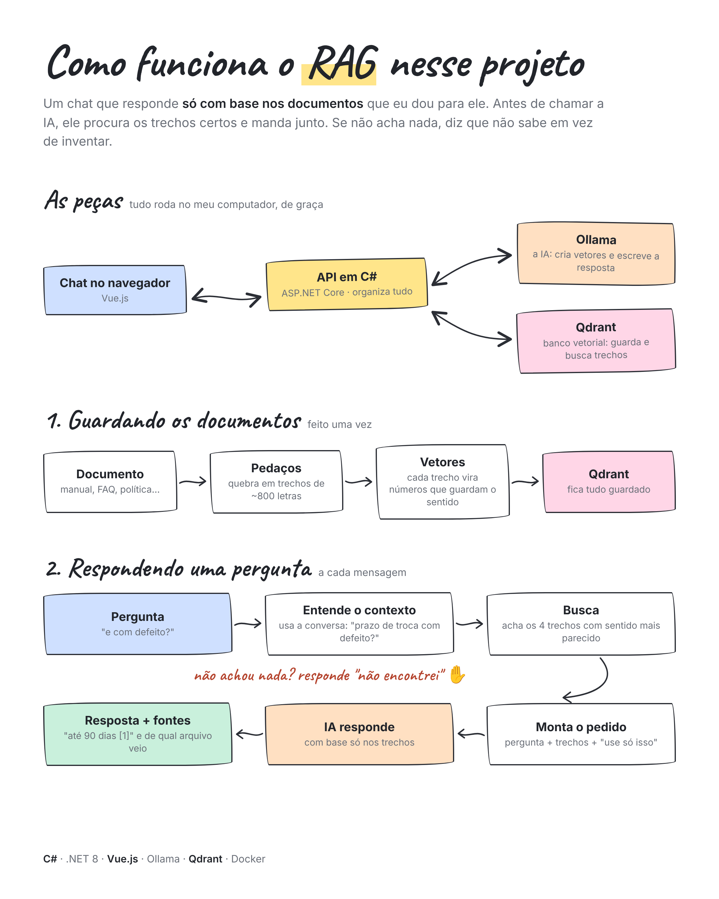
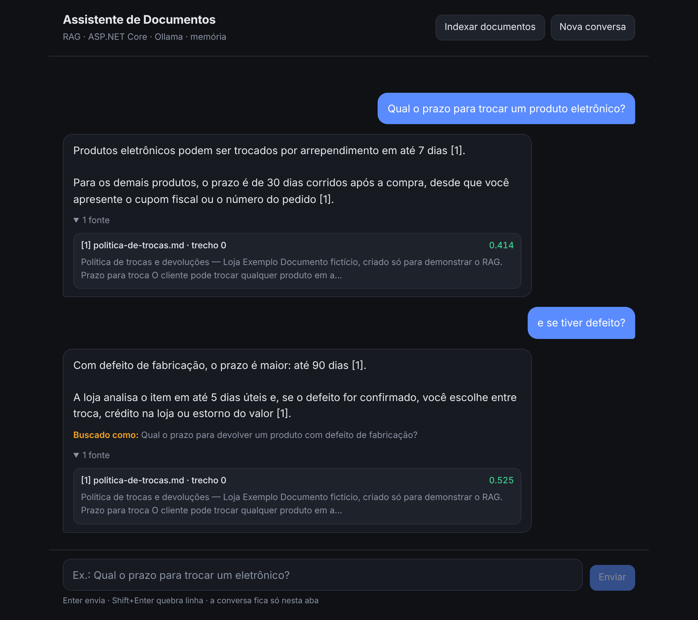
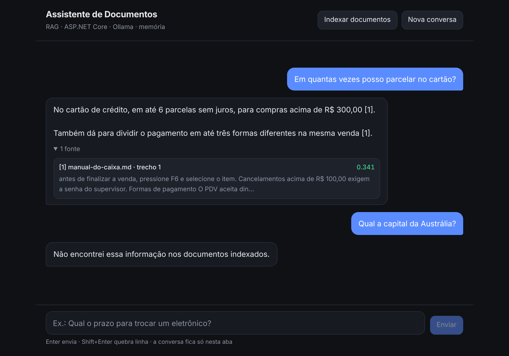
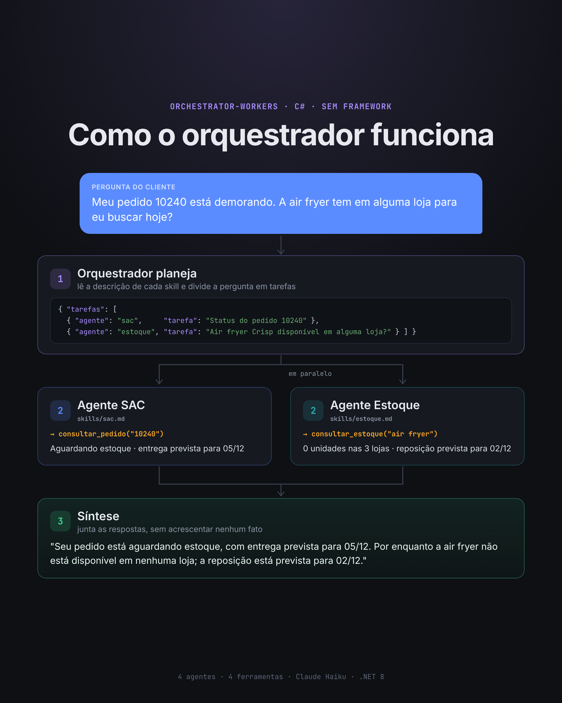
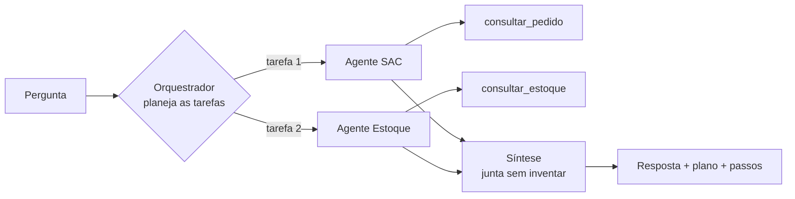
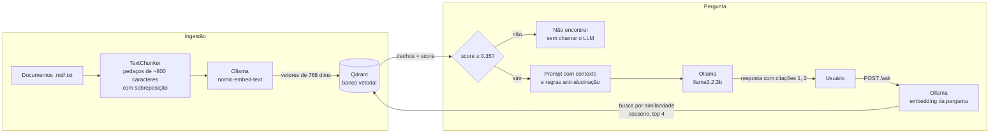
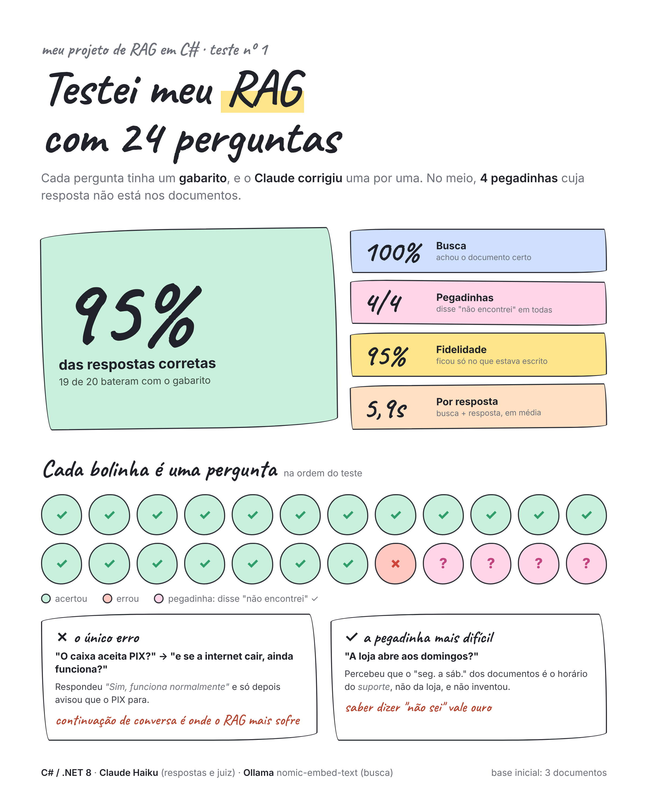

# Agentes + RAG em .NET: a equipe de IA da Loja Exemplo

Uma **equipe de agentes de IA** feita do zero em C#, sem framework: um **orquestrador** planeja, distribui as tarefas entre os especialistas (SAC, Caixa, Suporte e Estoque), roda todos em paralelo e junta as respostas. Cada especialista tem a sua **skill** (instruções, documentos que pode ler e ferramentas que pode usar). Por baixo, um **RAG** com banco vetorial busca nos documentos da loja.

Também é um assistente de chat em **ASP.NET Core 8 + Vue.js** que responde perguntas sobre os seus documentos usando **RAG** (Retrieval-Augmented Generation): busca os trechos certos num **banco vetorial** e só então pede para a IA responder, citando as fontes. Entende perguntas de continuação ("e com defeito?") usando o histórico da conversa.



<p align="center">
  
  
</p>

Roda local: **Qdrant** como banco vetorial e **Ollama** com modelos abertos. Para respostas melhores, o LLM pode ser trocado pelo **Claude** (pela sua conta do Claude Code, sem chave de API, ou pela API), e os embeddings pela **Voyage AI**. Tudo por configuração.

Tem também uma **avaliação automática** ([Fase 4](#avaliação-automática)): 24 perguntas com gabarito, e o próprio Claude corrigindo as respostas.

> **Zero pacotes NuGet.** O projeto fala com o Ollama e o Qdrant direto pela API REST, com `HttpClient` e `System.Text.Json`. A ideia é entender o que um SDK como Semantic Kernel faz por baixo dos panos antes de usar um.

---

## Orquestrador e agentes com skills





| Peça | Onde | O que faz |
|---|---|---|
| Skills | [`skills/*.md`](skills/) | Uma por departamento: cabeçalho com nome, descrição, documentos e ferramentas; corpo com as instruções. Para criar um agente novo, basta um arquivo |
| Orquestrador | `Agents/Orchestrator.cs` | **Planeja**: o LLM lê as descrições das skills e devolve `{"tarefas": [{"agente": "sac", "tarefa": "..."}]}`. Pergunta simples vira 1 tarefa; pergunta que mistura assuntos, até 3. **Delega** em paralelo (`Task.WhenAll`) e **sintetiza** as respostas sem acrescentar fatos |
| Loop do agente | `Agents/AgentRunner.cs` | O LLM responde sempre em JSON: `{"acao": "consultar_estoque", "args": {...}}` ou `{"acao": "responder", ...}`. O código executa a ferramenta e devolve o resultado, até 4 passos. Funciona com qualquer LLM, sem *tool calling* nativo |
| Ferramentas | `Agents/Tools.cs` | Busca nos documentos (cada agente só vê os do seu departamento), estoque e pedidos (dados fictícios em [`data/`](data/)) e abertura de chamados com protocolo |
| Avaliação | `Eval/AgentEvalRunner.cs` | 21 perguntas (3 que envolvem dois departamentos): mede se o plano escalou os agentes certos, se eles usaram a ferramenta certa e se a resposta está correta |

Na tela, o modo **Agentes** mostra o plano do orquestrador, quais especialistas trabalharam e cada passo que deram.

## Arquitetura do RAG



### Como as peças se encaixam

| Peça | Arquivo | Papel |
|---|---|---|
| Interfaces | `Abstractions.cs` | `IEmbeddingService`, `IChatService`, `IVectorStore`: trocar Ollama por OpenAI ou Qdrant por pgvector é só escrever outra implementação |
| Chunking | `Rag/TextChunker.cs` | Quebra o texto respeitando parágrafos, com *overlap* para não cortar ideias no meio |
| Embeddings e LLM locais | `Ai/OllamaServices.cs` | Chamadas `POST /api/embed` (em lote) e `POST /api/chat` |
| Claude pela sua conta | `Ai/ClaudeCodeChatService.cs` | Roda o Claude Code (`claude -p`) sem ferramentas, só como LLM |
| Claude pela API | `Ai/ClaudeChatService.cs` | `POST /v1/messages` da Anthropic, sem SDK |
| Embeddings Voyage | `Ai/VoyageEmbeddingService.cs` | `POST /v1/embeddings`, com `input_type` de documento ou pergunta |
| Montagem | `ServiceRegistration.cs` | Escolhe cada provedor pela configuração |
| Avaliação | `Eval/EvalRunner.cs` | Roda o gabarito e gera o relatório |
| Banco vetorial | `VectorStore/QdrantVectorStore.cs` | Cria a coleção, grava os pontos, apaga por documento, busca por similaridade |
| Banco em memória | `VectorStore/InMemoryVectorStore.cs` | Mesma interface, cosseno calculado à mão: roda sem Docker |
| Orquestração | `Rag/RagService.cs` | Os dois fluxos: ingestão e pergunta, reescrita da pergunta e o prompt |
| API | `Program.cs` | Minimal API com injeção de dependência; serve a tela de chat |
| Tela de chat | `wwwroot/index.html` | Vue 3 (via CDN, sem build): conversa, histórico e fontes de cada resposta |

### Decisões que valem explicar

- **Ids determinísticos.** Cada chunk recebe um UUID derivado de `arquivo + índice`. Antes de gravar, os chunks antigos daquele arquivo são apagados. Reindexar não duplica nada.
- **Dimensão descoberta em tempo de execução.** A coleção é criada com o tamanho do vetor que o modelo devolve. Trocar de modelo de embedding não exige mudar código (mas exige apagar a coleção antiga).
- **Score mínimo.** Se nenhum trecho passa de `MinScore`, a API responde "não encontrei" **sem chamar o LLM**. É a defesa mais simples contra alucinação.
- **Histórico no cliente.** A API não guarda estado: o chat envia as últimas mensagens junto com a pergunta (`MaxHistoryMessages`, padrão 6).
- **Reescrita da pergunta.** "E com defeito?" sozinho não acha nada no banco vetorial. Quando há histórico, o LLM primeiro reescreve a pergunta de forma completa, e é essa versão que vai para a busca. A tela mostra o texto buscado ("Buscado como").
- **Citações.** Os trechos vão numerados no prompt (`[1]`, `[2]`…) e a resposta devolve as fontes com score, para o usuário conferir.

---

## Como rodar

### Opção 1: tudo no Docker

```bash
docker compose up -d --build

# baixa os modelos (só na primeira vez, ~2,3 GB)
docker compose exec ollama ollama pull nomic-embed-text
docker compose exec ollama ollama pull llama3.2:3b

```

Abra **http://localhost:5080**, clique em **Indexar documentos** e converse.

### Opção 2: API no Visual Studio / Rider, serviços no Docker

```bash
docker compose up -d qdrant ollama
docker compose exec ollama ollama pull nomic-embed-text
docker compose exec ollama ollama pull llama3.2:3b

cd src/RagApi
dotnet run --urls http://localhost:5080
```

### Opção 3: sem Docker (só Ollama instalado)

Instale o Ollama pelo site oficial, baixe os dois modelos com `ollama pull` e rode a API com o banco vetorial em memória:

```bash
cd src/RagApi
dotnet run --urls http://localhost:5080 --VectorStore InMemory
```

Os vetores somem quando a API reinicia; é só indexar de novo.

O painel do Qdrant fica em **http://localhost:6333/dashboard**. Lá dá para ver os pontos gravados, os vetores e o payload de cada chunk. Vale um print para o LinkedIn.

O arquivo `requests.http` tem todas as chamadas prontas para o VS Code (extensão REST Client), Rider ou Visual Studio.

### Opção 4: com o Claude, pela sua conta (sem chave de API)

Usa o **Claude Code** instalado na sua máquina como LLM, com a conta em que você já está logado. O Ollama fica só com os embeddings, que são leves, e o banco vetorial fica em memória, então **não precisa de Docker**.

1. Instale o [Ollama](https://ollama.com) e baixe o modelo de embeddings: `ollama pull nomic-embed-text`
2. Instale o [Claude Code](https://code.claude.com/docs/en/setup), rode `claude` uma vez e faça login
3. Rode:

```bash
cd src/RagApi
dotnet run --launch-profile claude-code            # chat em http://localhost:5080
dotnet run --launch-profile claude-code -- eval    # avaliação
```

> Por baixo, a API chama `claude -p --output-format json --tools "" --system-prompt ...` e manda a conversa pelo stdin. Sem ferramentas, sem MCP e sem salvar sessão: o Claude Code vira só um LLM. Se instalou o Claude Code pelo npm no Windows, ajuste `ClaudeCode:Command` para `claude.cmd`.
>
> Isso é para testes e estudo na sua máquina. Para uma aplicação de verdade, use a API (opção 5).

### Opção 5: Claude e Voyage pela API

```bash
cd src/RagApi
dotnet user-secrets set "Claude:ApiKey" "sk-ant-..."
dotnet user-secrets set "Voyage:ApiKey" "pa-..."
dotnet run --launch-profile claude-api-voyage
```

As chaves ficam no **user-secrets** da sua máquina, fora do repositório. As variáveis `ANTHROPIC_API_KEY` e `VOYAGE_API_KEY` também funcionam.

### Testar sem baixar modelos

`tests/fake_ollama.py` imita a API do Ollama com embeddings simples por palavras e uma "resposta" que só devolve o primeiro trecho do contexto. Serve para testar ingestão, busca e montagem do prompt numa máquina fraca:

```bash
docker compose up -d qdrant
python3 tests/fake_ollama.py 11434
```

---

## Avaliação automática

```bash
cd src/RagApi
dotnet run --launch-profile claude-code -- eval            # RAG: 24 perguntas
dotnet run --launch-profile claude-code -- eval --agentes  # agentes: 21 perguntas
```

No Windows, o `rodar-avaliacao.bat` na raiz faz tudo isso com dois cliques.

### RAG

Mudar o prompt, o tamanho dos chunks ou o modelo pode melhorar ou piorar o RAG, e sem medir é só achismo. Por isso o projeto tem um gabarito em [`eval/perguntas.json`](eval/perguntas.json):

- **20 perguntas com resposta nos documentos**, cada uma com a resposta esperada e o arquivo de onde ela deve sair. Duas são perguntas de continuação ("e se tiver defeito?"), com histórico.
- **4 perguntas sem resposta** ("A loja abre aos domingos?"), em que o certo é dizer "não encontrei".

```bash
cd src/RagApi
dotnet run --launch-profile claude-code -- eval            # com o Claude como juiz
dotnet run --launch-profile claude-code -- eval --sem-juiz # só busca e recusa, mais rápido
```

| Métrica | O que mede | Como |
|---|---|---|
| **Busca** | O documento certo veio entre os trechos encontrados? | Comparação direta com o gabarito |
| **Respostas corretas** | A resposta bate com o gabarito? | LLM como juiz |
| **Fidelidade** | Tudo o que a resposta afirma está nos trechos? | LLM como juiz |
| **Recusa correta** | Disse "não encontrei" quando a resposta não existe? | Direto, ou juiz quando a IA chegou a responder |
| **Recusa indevida** | Disse "não encontrei" mas a resposta existia? | Direto |
| **Tempo** | Quanto demora cada pergunta | Cronômetro |

O relatório sai em `eval/resultados/` como Markdown: o resumo, uma tabela pergunta a pergunta e todas as respostas. Rodando de novo depois de uma mudança, dá para comparar o antes e o depois.

### Primeiro resultado (Claude Haiku + nomic-embed-text)



| Busca | Respostas corretas | Fidelidade | Recusa correta | Recusa indevida | Tempo médio |
|:-:|:-:|:-:|:-:|:-:|:-:|
| 100% | 95% | 95% | 4/4 | 0 | 5,9 s |

O único erro foi numa pergunta de continuação ("e se a internet cair, ainda funciona?", depois de perguntar sobre PIX): ele respondeu "sim" e só depois avisou que o PIX fica indisponível. Relatório completo em [`eval/resultados/`](eval/resultados/).

> A base ainda é pequena (3 documentos, 6 trechos, e a busca traz 4), então a busca em 100% é fácil. O próximo passo é aumentar a base para a métrica de busca ficar exigente.

## Endpoints

| Método | Rota | Corpo | O que faz |
|---|---|---|---|
| GET | `/health` | — | Verifica se a API está de pé |
| POST | `/ingest/folder` | — | Indexa todos os `.md` e `.txt` de `Rag:DocsPath` |
| POST | `/ingest` | `{ "source": "...", "text": "..." }` | Indexa um texto avulso |
| POST | `/agent` | `{ "question": "...", "history": [...] }` | Pergunta para a equipe de agentes; devolve o agente, a resposta, os passos e as fontes |
| GET | `/agents` | — | Lista as skills carregadas |
| GET | `/chamados` | — | Chamados abertos pelos agentes |
| POST | `/ask` | `{ "question": "...", "history": [{ "role": "user", "content": "..." }] }` | Responde com base nos documentos; `history` é opcional |
| GET | `/` | — | Tela de chat |

Exemplo de resposta do `/ask`:

```json
{
  "answer": "Produtos eletrônicos podem ser trocados por arrependimento em até 7 dias [1].",
  "sources": [
    { "ref": 1, "source": "politica-de-trocas.md", "chunkIndex": 0, "score": 0.78, "preview": "# Política de trocas…" }
  ],
  "searchQuery": "Qual o prazo para trocar um produto eletrônico?"
}
```

## Configuração (`appsettings.json`)

| Chave | Padrão | Para que serve |
|---|---|---|
| `Llm:Provider` | `Ollama` | `Ollama`, `ClaudeCode` (sua conta) ou `Claude` (API) |
| `Embeddings:Provider` | `Ollama` | `Ollama` ou `Voyage` |
| `ClaudeCode:Model` | `haiku` | `haiku`, `sonnet` ou `opus` |
| `Claude:Model` | `claude-haiku-5-5` | Modelo usado pela API |
| `Voyage:Model` | `voyage-4` | Modelo de embeddings da Voyage |
| `Ollama:EmbeddingModel` | `nomic-embed-text` | Modelo que gera os vetores |
| `Ollama:ChatModel` | `llama3.2:3b` | Modelo que escreve a resposta (troque por `qwen2.5:7b` se tiver GPU) |
| `Rag:ChunkSize` / `ChunkOverlap` | `800` / `150` | Tamanho dos pedaços e quanto um repete do anterior |
| `Rag:TopK` | `4` | Quantos trechos vão para o prompt |
| `Rag:MinScore` | `0.35` | Similaridade mínima para usar um trecho |
| `Rag:MaxHistoryMessages` | `6` | Quantas mensagens anteriores considerar |
| `VectorStore` | `Qdrant` | `Qdrant` ou `InMemory` |

---

## Próximos passos (roadmap)

- [ ] **Streaming** da resposta (`stream: true` no Ollama + Server-Sent Events)
- [ ] **Busca híbrida**: vetores + palavras-chave (BM25), melhor para códigos e nomes próprios
- [ ] **Reranking** dos trechos antes de mandar ao LLM
- [x] **Avaliação**: gabarito com 24 perguntas e LLM como juiz
- [x] **Claude** como LLM (pela conta ou pela API) e **Voyage** para embeddings
- [x] **Agentes por departamento** (SAC, Caixa, Suporte, Estoque) com skills e ferramentas
- [ ] **OpenTelemetry**: rastrear cada etapa (reescrita, busca, LLM) com tempos
- [ ] **Servidor MCP** para outras IAs consultarem os documentos
- [ ] Segunda implementação de `IVectorStore` com **PostgreSQL + pgvector**
- [ ] Ler **PDF** além de Markdown e texto
- [ ] Testes unitários do `TextChunker`

## Stack

C# · .NET 8 · ASP.NET Core Minimal API · Vue.js 3 · Qdrant · Ollama · Claude · Voyage AI · Docker Compose

A imagem da arquitetura é gerada a partir de `assets/arquitetura.html` (abra no navegador e tire um print em 1200×1500 se quiser editar).

Os documentos da pasta `docs/` são **fictícios**, criados só para a demonstração.
