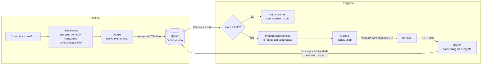

# RAG em .NET com Qdrant e Ollama

Assistente de chat em **ASP.NET Core 8 + Vue.js** que responde perguntas sobre os seus documentos usando **RAG** (Retrieval-Augmented Generation): busca os trechos certos num **banco vetorial** e só então pede para a IA responder, citando as fontes. Entende perguntas de continuação ("e com defeito?") usando o histórico da conversa.


<p align="center">
  
  
</p>

Tudo roda local e de graça: **Qdrant** como banco vetorial e **Ollama** com modelos abertos. Nenhuma chave de API.

> **Zero pacotes NuGet.** O projeto fala com o Ollama e o Qdrant direto pela API REST, com `HttpClient` e `System.Text.Json`. A ideia é entender o que um SDK como Semantic Kernel faz por baixo dos panos antes de usar um.

---

## Arquitetura



### Como as peças se encaixam

| Peça | Arquivo | Papel |
|---|---|---|
| Interfaces | `Abstractions.cs` | `IEmbeddingService`, `IChatService`, `IVectorStore`: trocar Ollama por OpenAI ou Qdrant por pgvector é só escrever outra implementação |
| Chunking | `Rag/TextChunker.cs` | Quebra o texto respeitando parágrafos, com *overlap* para não cortar ideias no meio |
| Embeddings e LLM | `Ai/OllamaServices.cs` | Chamadas `POST /api/embed` (em lote) e `POST /api/chat` |
| Banco vetorial | `VectorStore/QdrantVectorStore.cs` | Cria a coleção, grava os pontos, apaga por documento, busca por similaridade |
| Banco em memória | `VectorStore/InMemoryVectorStore.cs` | Mesma interface, cosseno calculado à mão: roda sem Docker |
| Orquestração | `Rag/RagService.cs` | Os dois fluxos: ingestão e pergunta, reescrita da pergunta e o prompt |
| API | `Program.cs` | Minimal API com injeção de dependência; serve a tela de chat |
| Tela de chat | `wwwroot/index.html` | Vue 3 (via CDN, sem build): conversa, histórico e fontes de cada resposta |

### Decisões que valem explicar

- **Ids determinísticos.** Cada chunk recebe um UUID derivado de `arquivo + índice`. Antes de gravar, os chunks antigos daquele arquivo são apagados. Reindexar não duplica nada.
- **Dimensão descoberta em tempo de execução.** A coleção é criada com o tamanho do vetor que o modelo devolve. Trocar de modelo de embedding não exige mudar código (mas exige apagar a coleção antiga).
- **Score mínimo.** Se nenhum trecho passa de `MinScore`, a API responde "não encontrei" **sem chamar o LLM**. É a defesa mais simples contra alucinação.
- **Histórico no cliente.** A API não guarda estado: o chat envia as últimas mensagens junto com a pergunta (`MaxHistoryMessages`, padrão 6).
- **Reescrita da pergunta.** "E com defeito?" sozinho não acha nada no banco vetorial. Quando há histórico, o LLM primeiro reescreve a pergunta de forma completa, e é essa versão que vai para a busca. A tela mostra o texto buscado ("Buscado como").
- **Citações.** Os trechos vão numerados no prompt (`[1]`, `[2]`…) e a resposta devolve as fontes com score, para o usuário conferir.

---

## Como rodar

### Opção 1: tudo no Docker

```bash
docker compose up -d --build

# baixa os modelos (só na primeira vez, ~2,3 GB)
docker compose exec ollama ollama pull nomic-embed-text
docker compose exec ollama ollama pull llama3.2:3b

```

Abra **http://localhost:5080**, clique em **Indexar documentos** e converse.

### Opção 2: API no Visual Studio / Rider, serviços no Docker

```bash
docker compose up -d qdrant ollama
docker compose exec ollama ollama pull nomic-embed-text
docker compose exec ollama ollama pull llama3.2:3b

cd src/RagApi
dotnet run --urls http://localhost:5080
```

### Opção 3: sem Docker (só Ollama instalado)

Instale o Ollama pelo site oficial, baixe os dois modelos com `ollama pull` e rode a API com o banco vetorial em memória:

```bash
cd src/RagApi
dotnet run --urls http://localhost:5080 --VectorStore InMemory
```

Os vetores somem quando a API reinicia; é só indexar de novo.

O painel do Qdrant fica em **http://localhost:6333/dashboard**. Lá dá para ver os pontos gravados, os vetores e o payload de cada chunk. Vale um print para o LinkedIn.

O arquivo `requests.http` tem todas as chamadas prontas para o VS Code (extensão REST Client), Rider ou Visual Studio.

### Testar sem baixar modelos

`tests/fake_ollama.py` imita a API do Ollama com embeddings simples por palavras e uma "resposta" que só devolve o primeiro trecho do contexto. Serve para testar ingestão, busca e montagem do prompt numa máquina fraca:

```bash
docker compose up -d qdrant
python3 tests/fake_ollama.py 11434
```

---

## Endpoints

| Método | Rota | Corpo | O que faz |
|---|---|---|---|
| GET | `/health` | — | Verifica se a API está de pé |
| POST | `/ingest/folder` | — | Indexa todos os `.md` e `.txt` de `Rag:DocsPath` |
| POST | `/ingest` | `{ "source": "...", "text": "..." }` | Indexa um texto avulso |
| POST | `/ask` | `{ "question": "...", "history": [{ "role": "user", "content": "..." }] }` | Responde com base nos documentos; `history` é opcional |
| GET | `/` | — | Tela de chat |

Exemplo de resposta do `/ask`:

```json
{
  "answer": "Produtos eletrônicos podem ser trocados por arrependimento em até 7 dias [1].",
  "sources": [
    { "ref": 1, "source": "politica-de-trocas.md", "chunkIndex": 0, "score": 0.78, "preview": "# Política de trocas…" }
  ],
  "searchQuery": "Qual o prazo para trocar um produto eletrônico?"
}
```

## Configuração (`appsettings.json`)

| Chave | Padrão | Para que serve |
|---|---|---|
| `Ollama:EmbeddingModel` | `nomic-embed-text` | Modelo que gera os vetores |
| `Ollama:ChatModel` | `llama3.2:3b` | Modelo que escreve a resposta (troque por `qwen2.5:7b` se tiver GPU) |
| `Rag:ChunkSize` / `ChunkOverlap` | `800` / `150` | Tamanho dos pedaços e quanto um repete do anterior |
| `Rag:TopK` | `4` | Quantos trechos vão para o prompt |
| `Rag:MinScore` | `0.35` | Similaridade mínima para usar um trecho |
| `Rag:MaxHistoryMessages` | `6` | Quantas mensagens anteriores considerar |
| `VectorStore` | `Qdrant` | `Qdrant` ou `InMemory` |

---

## Próximos passos (roadmap)

- [ ] **Streaming** da resposta (`stream: true` no Ollama + Server-Sent Events)
- [ ] **Busca híbrida**: vetores + palavras-chave (BM25), melhor para códigos e nomes próprios
- [ ] **Reranking** dos trechos antes de mandar ao LLM
- [ ] **Avaliação**: um conjunto de perguntas com respostas esperadas para medir se mudanças melhoram ou pioram
- [ ] Segunda implementação de `IVectorStore` com **PostgreSQL + pgvector**
- [ ] Ler **PDF** além de Markdown e texto
- [ ] Testes unitários do `TextChunker`

## Stack

C# · .NET 8 · ASP.NET Core Minimal API · Vue.js 3 · Qdrant · Ollama · Docker Compose

A imagem da arquitetura é gerada a partir de `assets/arquitetura.html` (abra no navegador e tire um print em 1200×1500 se quiser editar).

Os documentos da pasta `docs/` são **fictícios**, criados só para a demonstração.
